# Architecture decisions

These records capture decisions that are easy to undo accidentally when looking at one file in isolation. They are intentionally lightweight: context, decision, and consequences rather than a separate process or numbering tool.

## Decision map

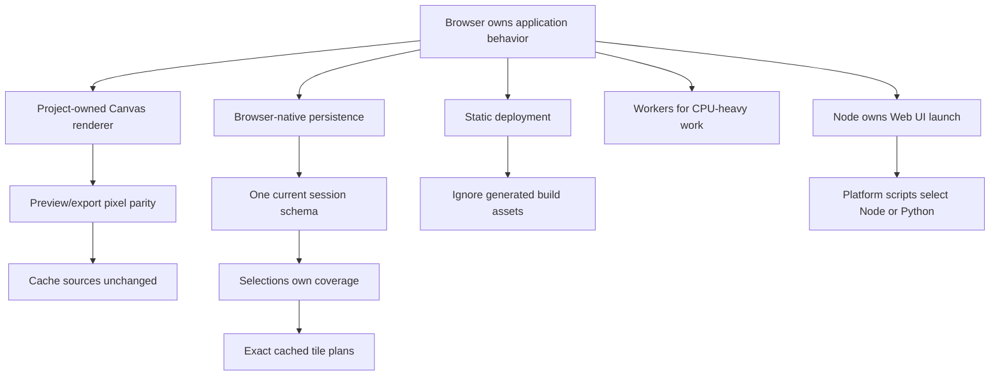

## Browser-only application behavior

### Context

The original desktop UI depends on Tk and therefore on a native desktop display stack. A Wayland-native or ordinary web-browser workflow must not require X11, XWayland, or a long-running Python application server.

### Decision

All new Web UI behavior runs in the browser and its local server is owned by Node/Vite. Python exposes no Web UI files and no project, search, render, export, job, or download API.

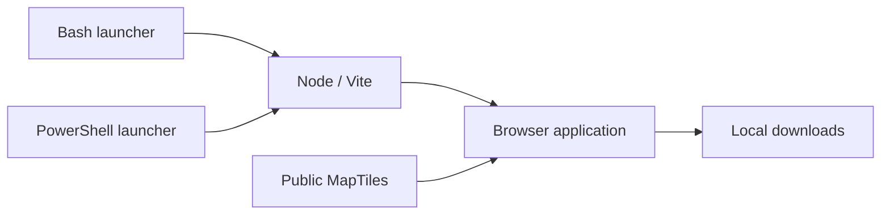

### Consequences

- User project data stays in the browser unless the user downloads or uploads a session.
- Browser APIs constrain implementation choices.
- Large exports depend on browser memory and MapTile availability.

## Source data remains unmodified

### Context

Caching converted or restyled source responses would blur the boundary between third-party data and project output, multiply cache variants, and risk stale conversion settings.

### Decision

Cache fetched source responses unchanged. Apply styling, overlays, and e-ink conversion after source retrieval.

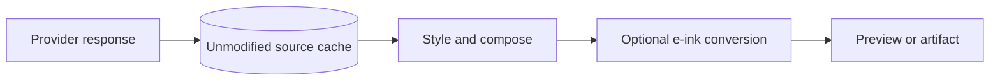

### Consequences

- One source response supports every render mode.
- Changing bit depth does not refetch source data.
- Rendered output needs a separate revision-aware memory cache.
- Offline reuse is bounded by browser Cache Storage and provider response semantics.

## Selections are the only coverage authority

### Context

A viewport rectangle, grid picker, search result, or visible overlay can all look like “the selected map” while meaning different things. Multiple competing coverage concepts made size estimates and exports hard to predict.

### Decision

Only enabled `AreaSelection` records contribute tiles. Each selection owns geometry and an independent min/max zoom. Overlaps are deduplicated.

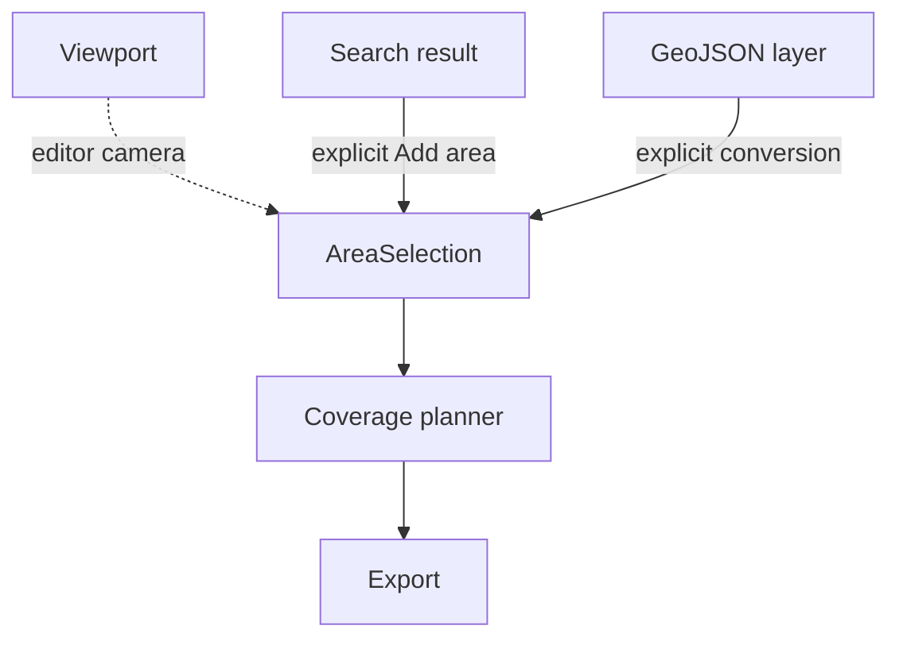

### Consequences

- Size estimates and downloads share one definition of coverage.
- **View** remains navigation-only.
- There is no manual tile-grid mode.
- Visible GeoJSON may affect pixels without affecting coverage until selected.

## Exact coverage planning happens independently of rendering

### Context

Rendering every possible tile whenever a selection zoom changes made the interface progressively slower. A bbox-only estimate is fast but inaccurate for irregular polygons.

### Decision

Compute exact polygon/tile coverage in a worker before export, cache it per selection and zoom, and calculate raw output size mathematically from the completed tile list. Do not render tiles while estimating coverage.

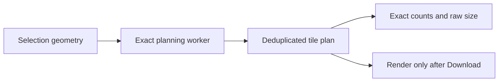

### Consequences

- High maximum zoom can still require substantial geometry work, but it does not trigger tile rendering.
- Progress represents candidate intersection, not download/render progress.
- Depth changes reuse the same plan.
- Export can begin immediately from a matching completed plan.

## Web Workers isolate CPU-heavy operations

### Context

Polygon intersection and per-pixel conversion can block pointer input and painting.

### Decision

Run exact planning and e-ink conversion in typed Web Workers. Keep DOM Canvas rendering on the main thread and bound concurrency.

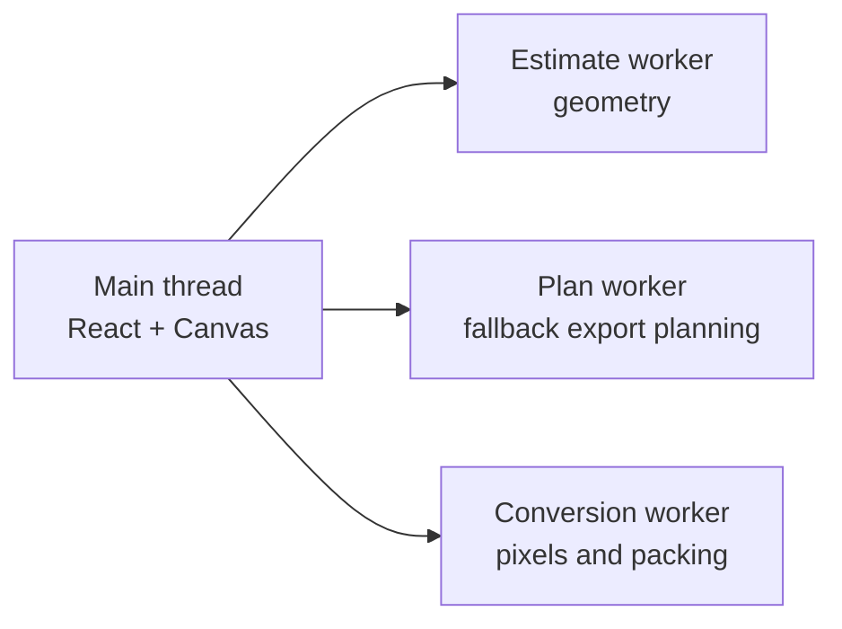

### Consequences

- The UI remains responsive during CPU-heavy loops.
- Protocols and error states must be explicit.
- Worker bundles are separate generated assets.
- Cancellation usually terminates a worker or rejects pending conversion work.

## One current portable session schema

### Context

Permanent fallback logic for every development-era browser schema makes normalization harder to reason about and can silently reinterpret stale state.

### Decision

Accept portable session version 3 only. Validate it at the persistence/import boundary. Do not carry version-2 migration logic.

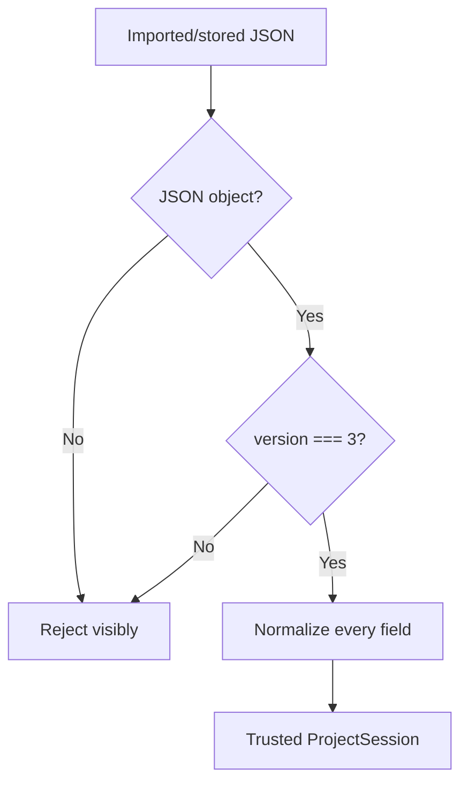

### Consequences

- Internal code handles one normalized shape.
- Old development sessions may need to be reset or manually recreated.
- A future incompatible version requires an explicit migration decision rather than accidental fallback.

## Two revisions separate persistence from pixel invalidation

### Context

Every project edit must persist, but not every edit changes tile pixels. Using one revision either leaves stale pixels or invalidates expensive render work unnecessarily.

### Decision

Track a general `revision` and a narrower `render_revision`. Expose `save`, `saveRender`, and `updateView` according to intent.

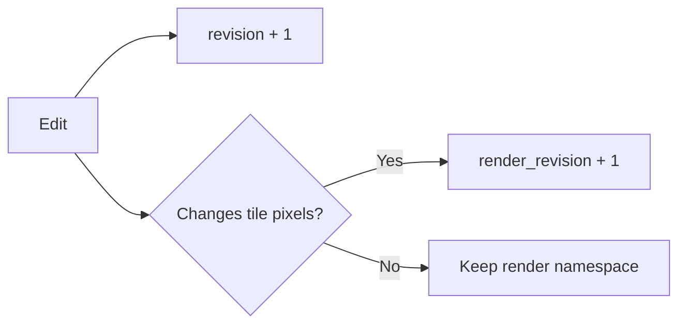

### Consequences

- Coverage edits do not flush preview/export render reuse.
- Developers must classify mutations correctly.
- Documentation and review must treat save-path choice as a correctness concern.

## Keep the original desktop application

### Context

The Web UI replaces the need for X11 in the new workflow, but existing desktop users and behavior should not be broken by the migration.

### Decision

Keep Tkinter as the default mode for compatibility. Platform launchers under `scripts/` handle `--ui`: Bash serves Unix-like systems and PowerShell serves Windows. Both execute Python for Tkinter and Node/Vite for Web mode. The Python package exposes only the direct `eink-map-tiles-app` desktop entry point.

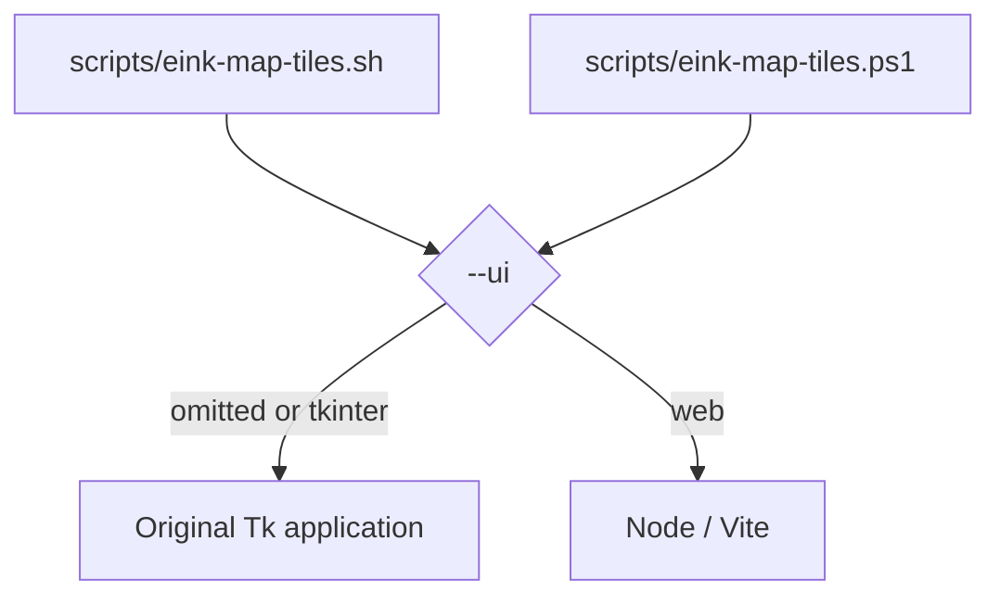

### Consequences

- Browser work should avoid unrelated changes to the desktop implementation.
- Shared Python core behavior must continue passing its tests.
- Web mode requires Node.js 22 and installed npm dependencies, but not Python.
- A future default-mode change is a separate compatibility decision.

## Prefer explicit modules over a framework layer

### Context

The application has only two map sources, four output kinds, and a small set of workflows. A plugin framework or general dependency-injection layer would add indirection without reducing current complexity.

### Decision

Use direct typed functions, discriminated unions, and focused modules. Extract shared policy only when real duplication or change pressure appears.

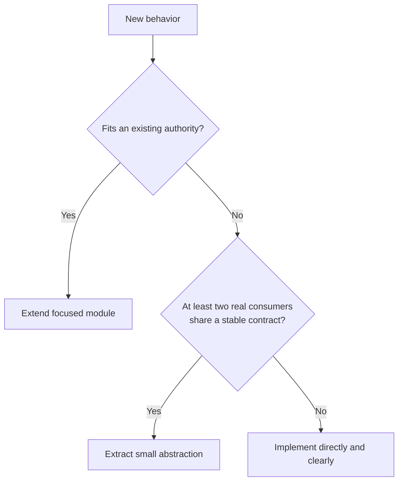

### Consequences

- Call paths remain easy to trace.
- Some cohesive modules are intentionally larger than tiny utility files.
- Refactoring should improve ownership or testability, not pursue line-count targets.

## Changing a decision

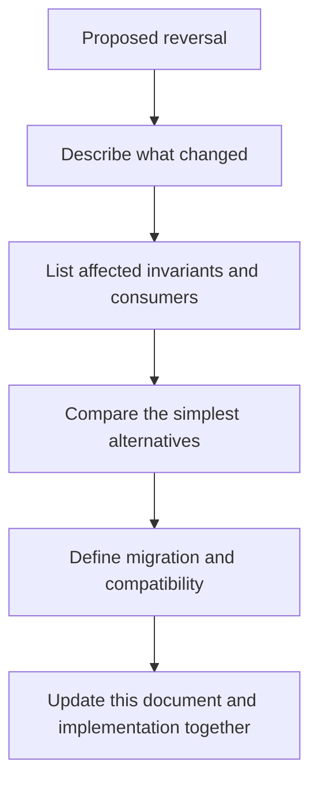

A decision may be reversed when its context no longer holds. Do not work around it locally; make the new decision explicit so future developers understand the new system rather than inheriting contradictory patterns.
