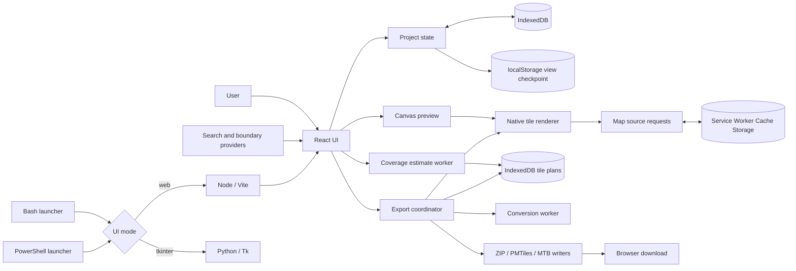
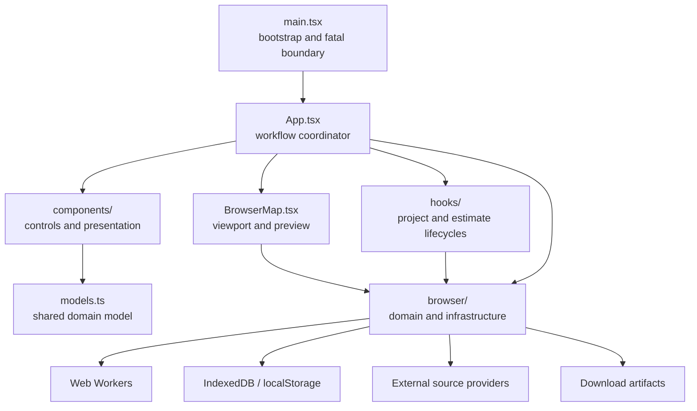
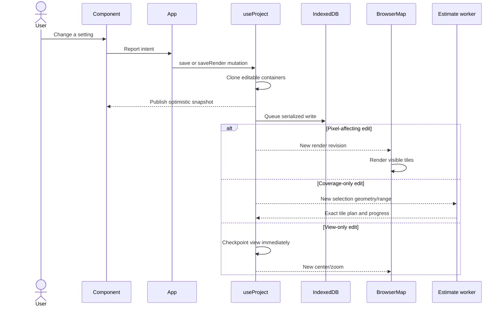
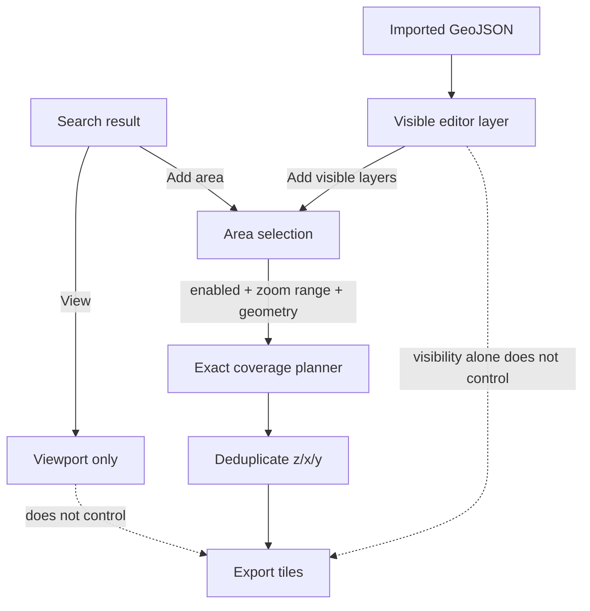
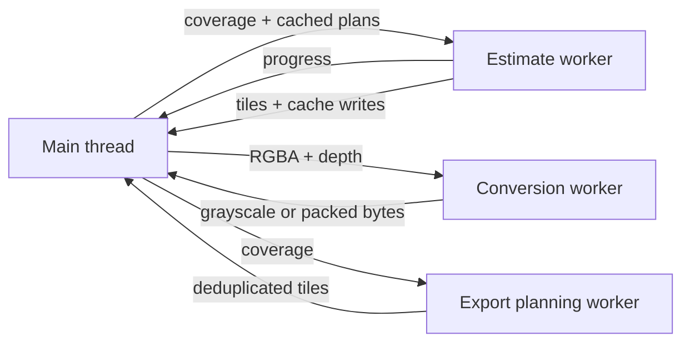
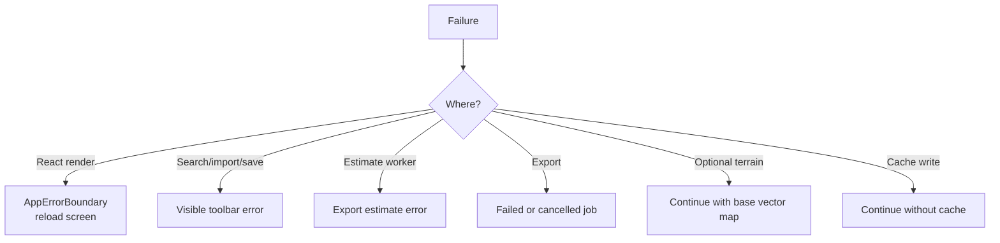

# Architecture

E-ink Map Tiles has two independent applications behind small platform launchers: Bash on Unix-like systems and PowerShell on Windows. Node/Vite starts the browser application; Python starts the preserved Tk desktop application. The browser owns search, map rendering, tile planning, conversion, persistence, compression, and downloads. There is no application API and no Python processing backend.

## Runtime boundary

## Module ownership

Ownership rules:

- `App.tsx` coordinates user workflows; it should not contain binary encoding, map math, or provider-specific parsing.
- Components render controls and report user intent. They do not own durable project state.
- Hooks own asynchronous React lifecycles and connect React to browser services.
- `webui/src/browser/` contains framework-independent logic, browser infrastructure, workers, renderers, and writers.
- `models.ts` describes the current in-memory and persisted application model.
- Worker request and response shapes live in one place so both sides compile against the same contract.

## Principal data flow

## Selection and export authority

Enabled selections are the only authority for export coverage. The viewport is an editor camera, not an export rectangle. A visible GeoJSON layer affects rendered pixels but does not become coverage until explicitly converted into a selection.

## Asynchronous work

- Geometry intersection is isolated from rendering and can be terminated by destroying its worker.
- Pixel conversion runs in a reusable worker client and transfers buffers instead of cloning completed results.
- Export rendering remains on the main thread because the renderer uses DOM Canvas APIs. Network and rendering concurrency is bounded.

## Error boundaries

Optional caches and topography degrade gracefully. Format generation, primary map-source failures, invalid sessions, and durable-save failures remain visible because silently continuing could produce an incorrect artifact.

## Non-negotiable invariants

1. Preview and export use the same native tile renderer and e-ink conversion.
2. Selection outlines are editor chrome and never enter an export.
3. Source responses are cached unchanged; conversion happens after rendering.
4. Search never adds coverage without an explicit **Add area** action.
5. Every exported tile comes from at least one enabled selection.
6. Overlapping selections emit a tile only once.
7. Imported session data is normalized at the storage boundary.
8. Geometry payloads are immutable after import so large objects can be retained by reference.
9. A source/style/marker/visible-overlay edit must advance `render_revision`.
10. A selection zoom-range edit must not invalidate rendered pixels.

## Where a change belongs

| Change                               | Primary location                                             | Required coverage                                         |
| ------------------------------------ | ------------------------------------------------------------ | --------------------------------------------------------- |
| Persisted session shape              | `models.ts` and `session.ts`                                 | Session normalization and persistence tests               |
| Rendered map pixels                  | `nativeRenderer.ts`, `eink.ts`, or related rendering modules | Focused renderer or conversion tests                      |
| Tile coverage                        | `tiles.ts`, the planning workers, and `workerProtocol.ts`    | Tile-planning and worker-contract tests                   |
| Download encoding                    | The corresponding format writer                              | Byte-level tests and an independent reader where possible |
| Search or boundary-provider behavior | `search.ts`                                                  | Mocked provider success, fallback, and failure tests      |
| Interface behavior only              | The responsible component, hook, or `App.tsx` workflow       | Component logic plus browser inspection                   |

See [Contributing](contributing.md) for the corresponding verification checklist.
