# Contributing

This guide is the shortest safe path from checkout to a reviewable change. Read [Architecture](architecture.md) first if the change crosses more than one subsystem.

## Prerequisites

- Python 3.10 or newer; CI uses Python 3.12.
- Node.js 22 or newer.
- A modern browser with Canvas, Web Workers, IndexedDB, Cache Storage, and service-worker support.
- Network access only for live map/search use. Automated tests are network-independent.

## Setup

From the repository root:

```bash
python -m venv .venv
.venv/bin/pip install -e ".[dev]"
cd webui
npm ci
```

Run the frontend during development:

```bash
./scripts/eink-map-tiles.sh --ui=web
```

The Bash and PowerShell launchers install locked npm dependencies when `webui/node_modules/` is absent, build the production application, start Vite’s preview server on port 8765, and let Vite select a nearby port when it is occupied. For hot-module replacement while developing, run `npm run dev` from `webui/` instead.

## Development loop

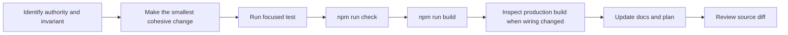

Prefer pure functions for math, parsing, validation, and encoding. Keep network and storage operations at explicit boundaries. Avoid adding an abstraction until at least two real callers need the same policy.

## Repository map

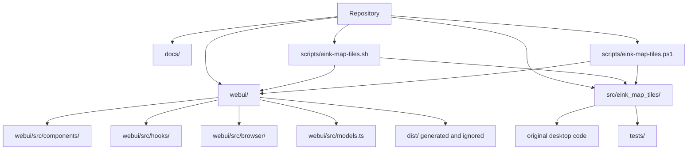

The original Tk application is preserved. Browser-only work should not move rendering or export logic into Python.

## Choosing a state mutation

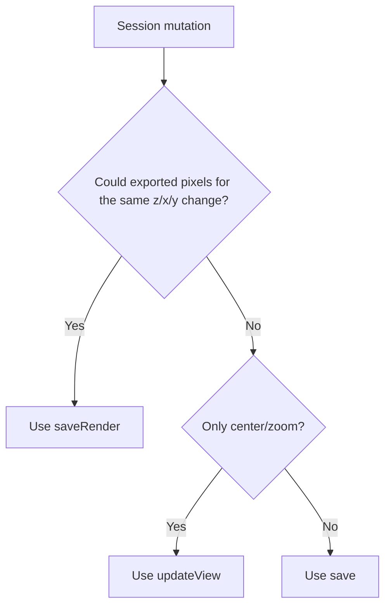

This decision is part of render-cache correctness. See [State and caching](state-and-caching.md) for examples.

## Adding a persisted field

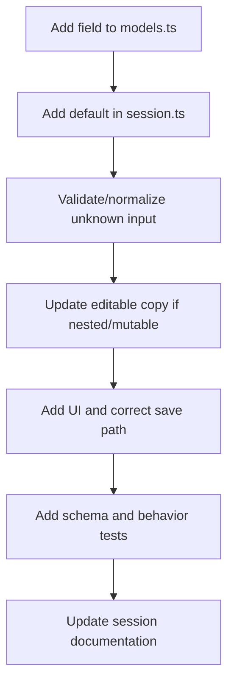

Do not read imported JSON with a type cast and trust it. All external session data enters as `unknown` and must be normalized. Version 3 is currently the only accepted schema.

## Adding a map source

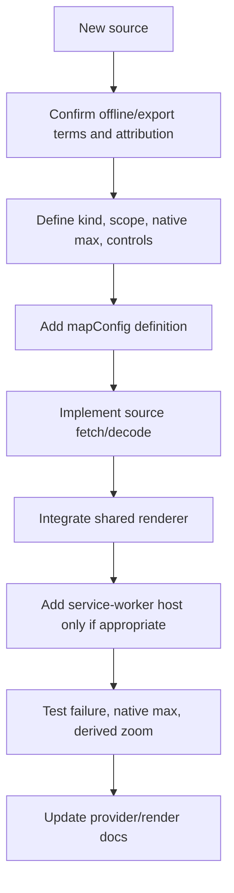

Checklist:

- Browser CORS works without a secret embedded in the client.
- Offline/export use is permitted for the intended deployment.
- Attribution is exact and included in the footer and artifacts.
- Native maximum zoom is verified from the service, not guessed.
- Derived zoom semantics are explicit.
- Source failures are visible unless the layer is optional.
- Element controls are offered only when the renderer can honor them.

## Changing vector style or labels

Keep schema knowledge and declarative policy distinguishable from Canvas mechanics. A style change normally belongs in `nativeRenderer.ts` today; if policy is extracted, use one `vectorStyle.ts` authority rather than scattered constants.

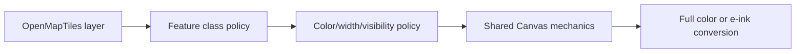

Verify low zoom, the source-native maximum, and at least one derived zoom. Roads and labels must remain legible in MTB1, not merely attractive in color.

## Adding a provider

Provider-specific response shapes must stop at `search.ts` or a small adjacent adapter. React receives normalized `SearchResult` values only.

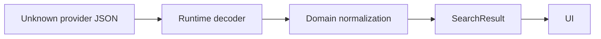

Document fallback position, timeout, scope, public-service policy, and attribution. Add mocked tests; never use the live service in CI.

## Adding an export kind

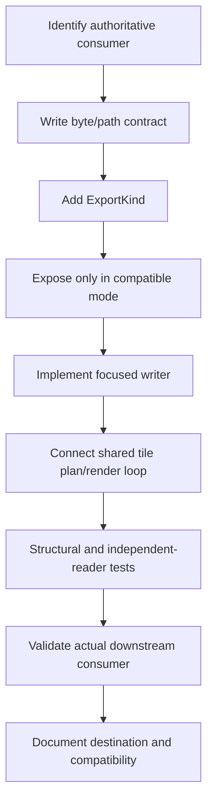

Do not duplicate map rendering inside a format writer. Writers receive rendered pixels or packed tiles from the shared pipeline.

## Adding or changing a worker

1. Define request and discriminated response unions in `workerProtocol.ts`.
2. Keep one long-lived worker only when work is naturally reusable; otherwise create one per calculation and terminate it.
3. Include an explicit error response and an `onerror` path.
4. Transfer large completed buffers rather than cloning them.
5. Decide what cancellation means and reject pending callers predictably.
6. Throttle progress messages so they do not become the workload.

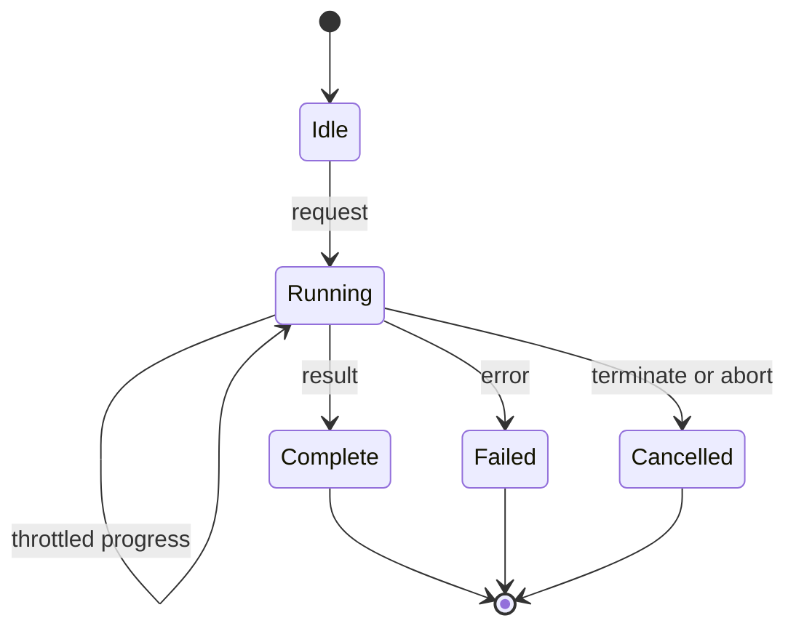

## Generated frontend assets

`npm run build` writes to `webui/dist/`. That directory contains deployable content-hashed bundles and is deliberately ignored. Never copy generated Web UI files into the Python package or commit them.

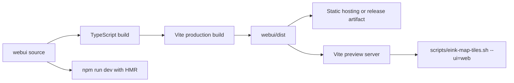

After a build:

- Do not commit `dist/`, `node_modules`, `*.tsbuildinfo`, or emitted `vite.config.js`/`.d.ts` files.
- Confirm `dist/index.html` references files present in the same build.
- Deploy the complete `dist/` directory atomically; do not combine output from separate builds.
- Commit source assets from `webui/public/` when they intentionally change.

## Required checks

From `webui/`:

```bash
npm run check
npm run build
```

From the repository root:

```bash
.venv/bin/python -m pytest -q
git diff --check
```

Run a fresh-browser production-build smoke when changing bootstrap, persistence, workers, service-worker behavior, generated asset paths, or the launcher. See [Testing strategy](testing.md).

## Review checklist

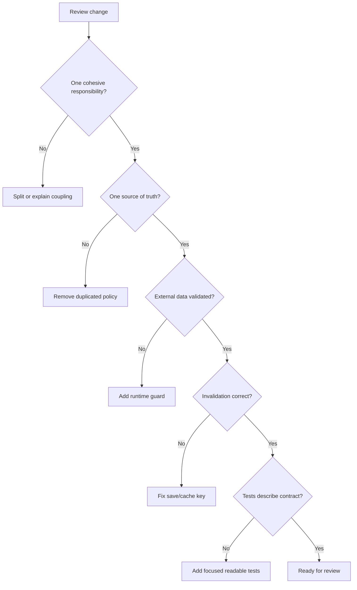

Before handing off:

- The change has a single clear authority for new policy.
- Preview and export still share rendering/conversion.
- Selection coverage remains independent from the viewport.
- New external JSON is treated as unknown.
- Errors are visible at the correct boundary.
- Cache invalidation is no broader than necessary and never too narrow.
- Tests explain the expected behavior without opaque snapshots or data-only golden files.
- Documentation names any downstream or provider assumption.
- `npm run check`, production build, Python tests, and `git diff --check` pass.

## Commit hygiene

Do not mix personal editor configuration into a project change. Preserve unrelated working-tree changes. Commit frontend source and public assets, but leave generated `dist/` bundles, local caches, and compiler metadata ignored.
