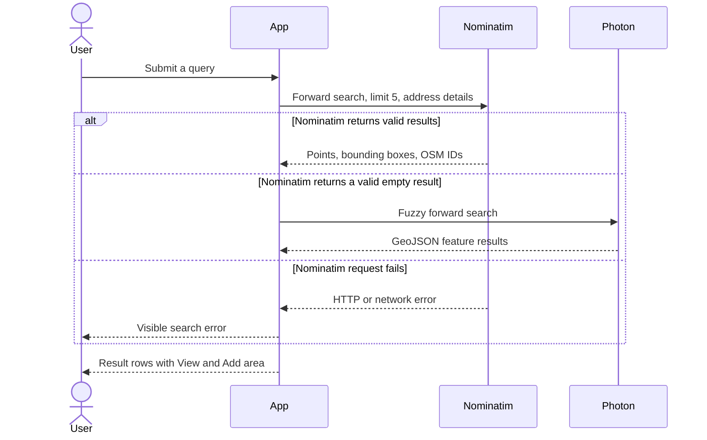
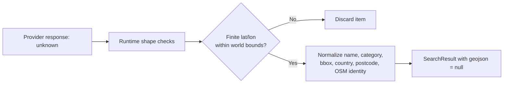
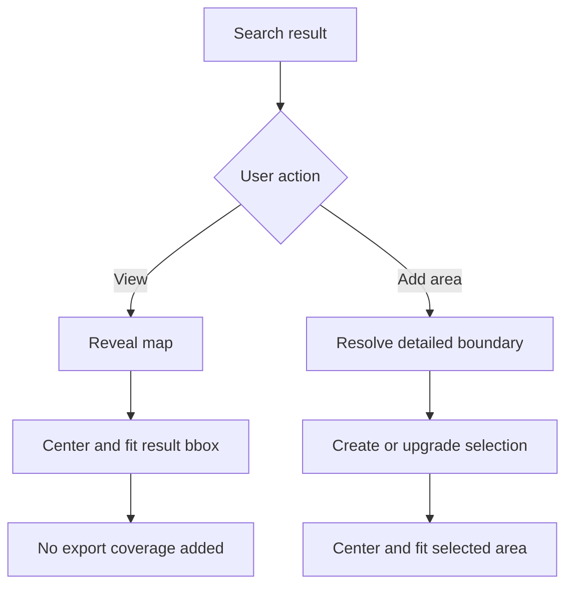
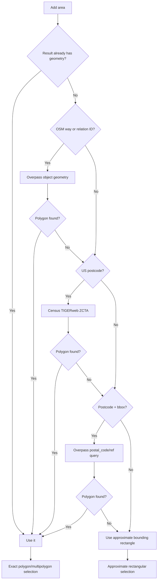
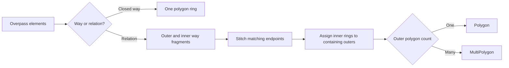
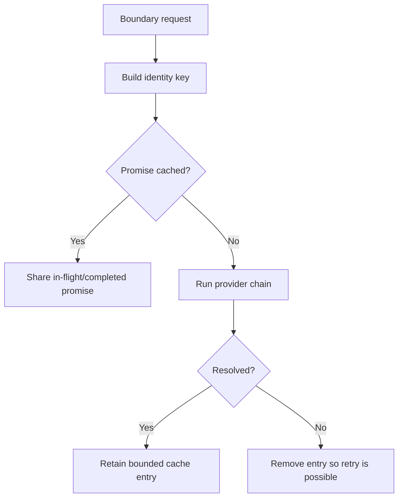
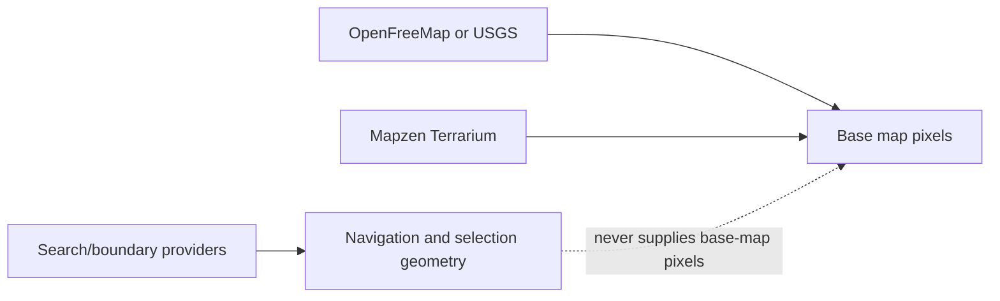
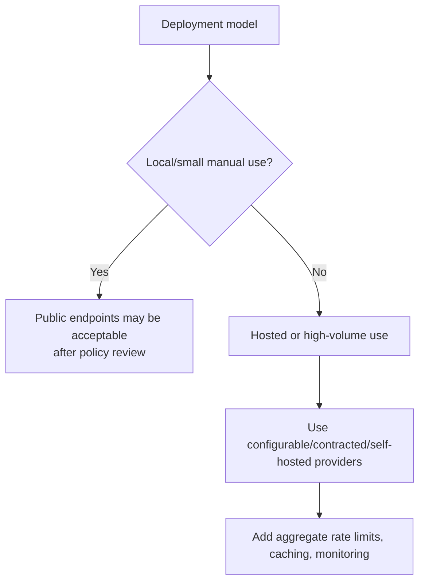

# Location search and boundary providers

Location search answers “where should the map look?” Boundary resolution answers “which exact geometry should become export coverage?” Keeping those operations separate makes search fast and avoids sending an expensive boundary request for every result.

Provider information in this document was reviewed on 2026-10-11. Public-service rules can change; re-check the linked primary documentation before a hosted release.

## Search flow

Search does not request polygon geometry. Even if a search response happens to contain geometry, the normalized `SearchResult` deliberately sets `geojson` to `null` until the user chooses **Add area**.

Stale requests are ignored using a monotonically increasing request ID. Changing the query invalidates the current request and dismisses the dropdown. It does not currently abort the provider request at the network layer.

## Search providers

| Provider                | Endpoint used                        | Role                                                                 | Timeout | Important behavior                                                |
| ----------------------- | ------------------------------------ | -------------------------------------------------------------------- | ------: | ----------------------------------------------------------------- |
| OpenStreetMap Nominatim | `nominatim.openstreetmap.org/search` | Primary worldwide forward search                                     |    12 s | Exact query submission only; no autocomplete requests             |
| Photon public demo      | `photon.komoot.io/api/`              | Fuzzy fallback when Nominatim successfully returns no usable results |    12 s | Builds readable names from name, city, county, state, and country |

The Nominatim public service currently requires light, user-triggered use, visible attribution, an identifying Referer/User-Agent, and no client-side autocomplete. Its stated absolute maximum is one request per second, and systematic/bulk queries are forbidden. See the [Nominatim Usage Policy](https://operations.osmfoundation.org/policies/nominatim/).

Photon describes `photon.komoot.io` as a public demo service suitable for reasonable use, without availability guarantees; extensive use may be throttled or blocked. See the [Photon project README](https://github.com/komoot/photon/blob/master/README.md) and [API documentation](https://github.com/komoot/photon/blob/master/docs/api-v1.md).

The present local application model—one request only after a user submits a search—is intentionally conservative. A broadly hosted deployment must review aggregate traffic and should make endpoints configurable or operate its own service.

## Result normalization

External JSON remains `unknown` until checked. Malformed items are discarded instead of being allowed into application state. Bounding boxes must have four finite coordinates, ordered south-to-north, within valid latitude/longitude ranges.

## View versus Add area

This distinction is an invariant. Do not make search submission or **View** create a selection as a convenience; it would make export coverage surprising.

## Boundary-resolution flow

The order is intentionally worldwide-first. The U.S. Census provider is a fallback for a U.S. postcode, not a default preference for U.S. results.

## Boundary providers

| Provider                             | When called                                                                      | Output                                          | Scope and caveat                                                                            |
| ------------------------------------ | -------------------------------------------------------------------------------- | ----------------------------------------------- | ------------------------------------------------------------------------------------------- |
| OpenStreetMap Overpass               | User adds a result with a way/relation identity                                  | Way polygon or stitched relation multipolygon   | Worldwide, best effort; relation member geometry can be incomplete or complex               |
| Census TIGERweb                      | OSM object resolution failed and the selected item is a five-digit U.S. postcode | ZCTA polygon/multipolygon                       | United States only; ZCTAs approximate postal delivery areas and are not USPS ZIP boundaries |
| OpenStreetMap Overpass postal search | Earlier resolution failed and a postcode plus bbox are available                 | Postal boundary matching `postal_code` or `ref` | Worldwide where OSM has a mapped postal boundary                                            |
| Search-result bbox                   | No detailed geometry was found                                                   | Rectangle                                       | Always marked approximate by `exact: false`                                                 |

TIGERweb provides REST services intended for GIS and custom web applications. Its datasets and service organization evolve by release; see the [TIGERweb overview](https://tigerweb.geo.census.gov/) and [REST service directory](https://tigerweb.geo.census.gov/arcgis/rest/services/TIGERweb).

Overpass requests are made only after an explicit selection. Do not move them back into search-result generation. A query-per-result pattern is slow for users and abusive toward shared public infrastructure.

## Overpass geometry construction

The stitcher is intentionally modest. It joins exact endpoint matches and uses point-in-ring containment for holes. If geometry cannot be constructed, resolution falls through rather than pretending the shape is exact.

## Boundary request cache

Resolved boundary work is cached in memory by OSM identity, country, postcode, and bbox. The cache stores at most 64 in-flight/completed promises.

Failures are not cached for the whole session. A timeout or temporary outage should be retryable when the user chooses the result again.

## Map and terrain sources

Location providers are separate from map-tile providers.

| Source             | Current endpoint                                                  | Primary documentation                                                                                                                                   |
| ------------------ | ----------------------------------------------------------------- | ------------------------------------------------------------------------------------------------------------------------------------------------------- |
| OpenFreeMap vector | `tiles.openfreemap.org/planet/latest/{z}/{x}/{y}.pbf`             | [OpenFreeMap Quick Start](https://openfreemap.org/quick_start/), [project attribution](https://github.com/hyperknot/openfreemap#attribution)            |
| USGS topo raster   | `basemap.nationalmap.gov/.../USGSTopo/MapServer/tile/{z}/{y}/{x}` | [USGSTopo service directory](https://basemap.nationalmap.gov/arcgis/rest/services/USGSTopo/MapServer)                                                   |
| Mapzen terrain     | `s3.amazonaws.com/elevation-tiles-prod/terrarium/{z}/{x}/{y}.png` | [Terrain Tiles dataset](https://registry.opendata.aws/terrain-tiles/), [Terrarium format](https://github.com/tilezen/joerd/blob/master/docs/formats.md) |

Attribution is centralized in `mapConfig.ts` and reused by the footer and exported artifacts. Adding a source requires adding its accurate attribution at the same time.

## Privacy and deployment guidance

- Search text is sent to the configured third-party geocoder.
- Selected OSM IDs, postcodes, and bounding boxes may be sent to Overpass or TIGERweb.
- Map coordinates are sent to tile and terrain providers as URL paths.
- No project session, marker label, or imported GeoJSON is intentionally uploaded by the application.
- The application has no proxy that can enforce global rate limits across users.

## Adding or replacing a provider

1. Document the user need and why existing providers cannot satisfy it.
2. Confirm browser CORS support, acceptable-use rules, attribution, privacy implications, and expected availability.
3. Keep provider response JSON at an `unknown` boundary and normalize it into existing domain types.
4. Do not expose raw provider objects to React components.
5. Preserve the distinction between search and boundary resolution.
6. Make timeouts and fallback order explicit.
7. Add mocked tests for success, empty results, malformed responses, HTTP failure, timeout/fallback, and geographic restrictions.
8. Update source attribution and this document.
