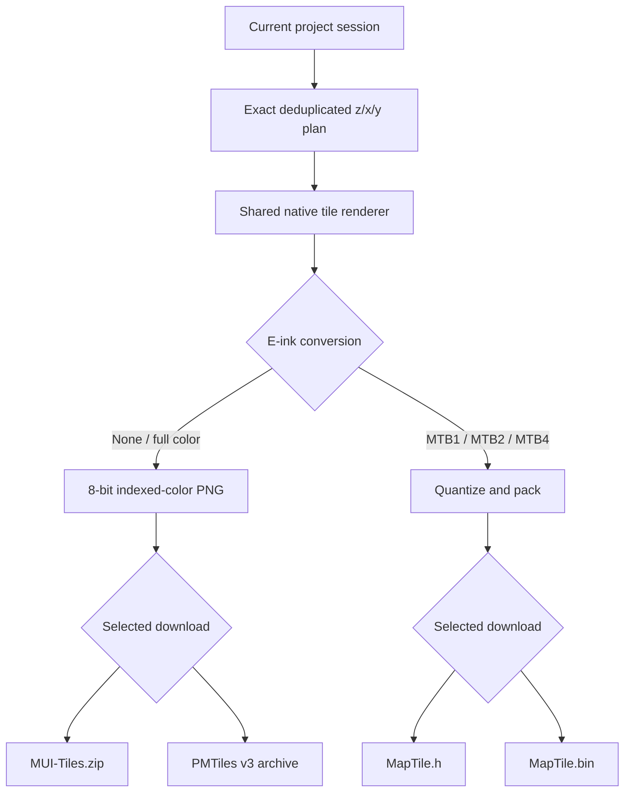
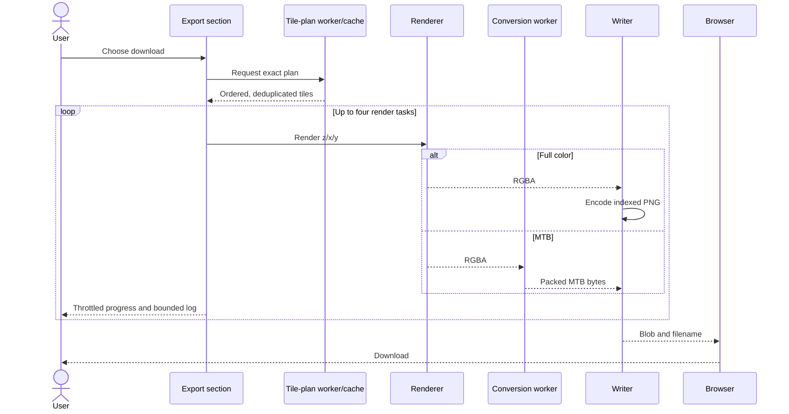
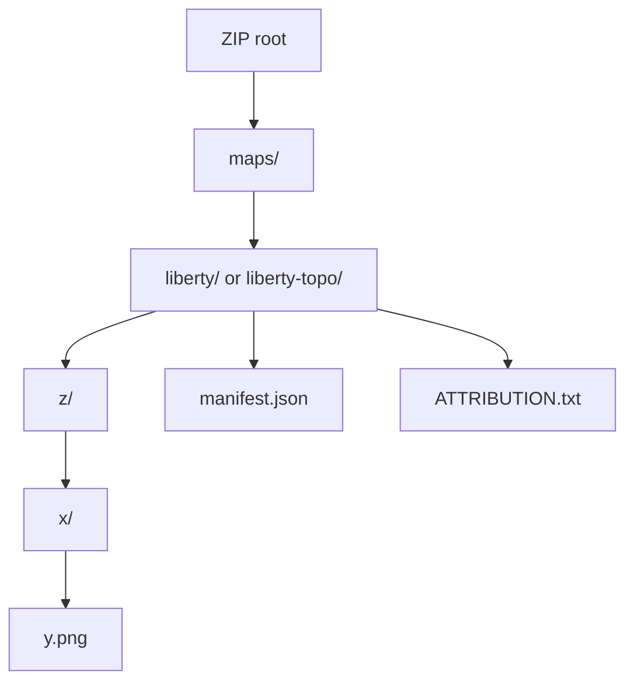
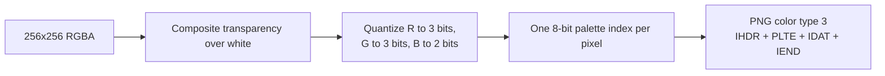
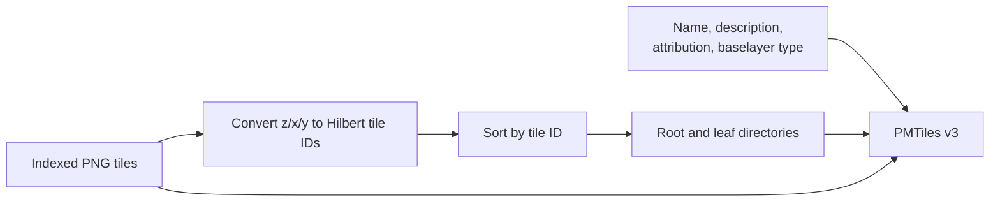
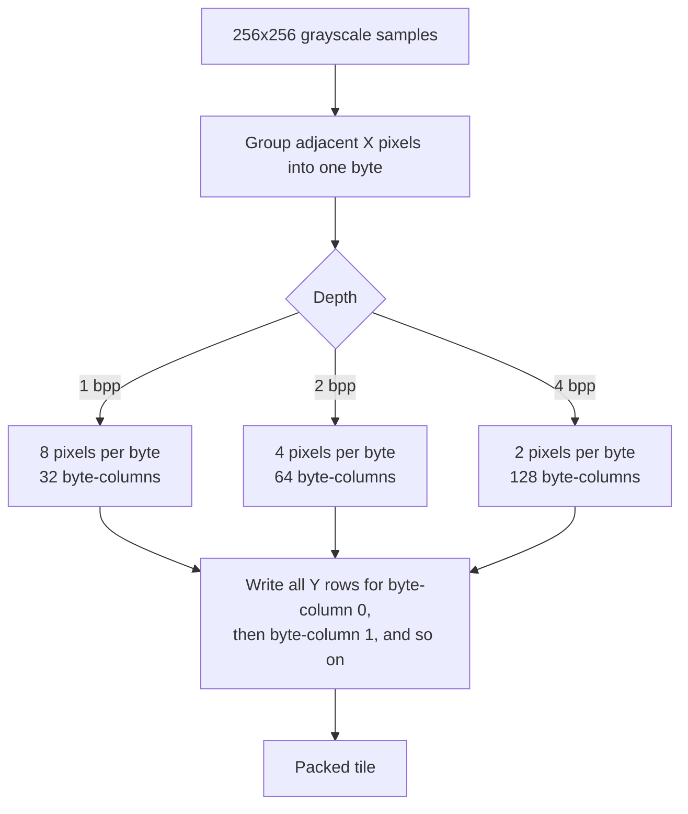
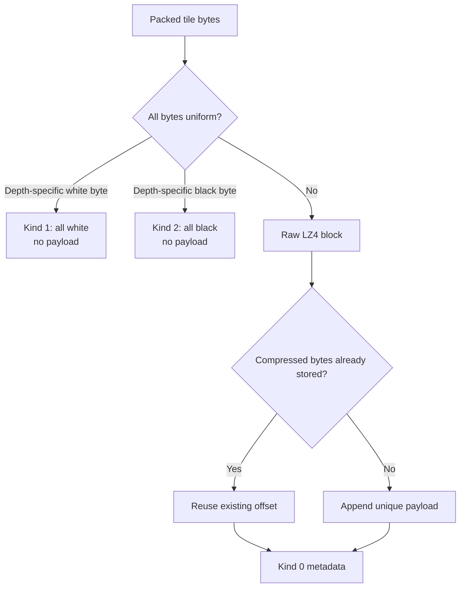
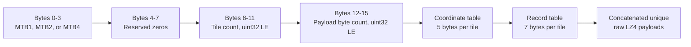
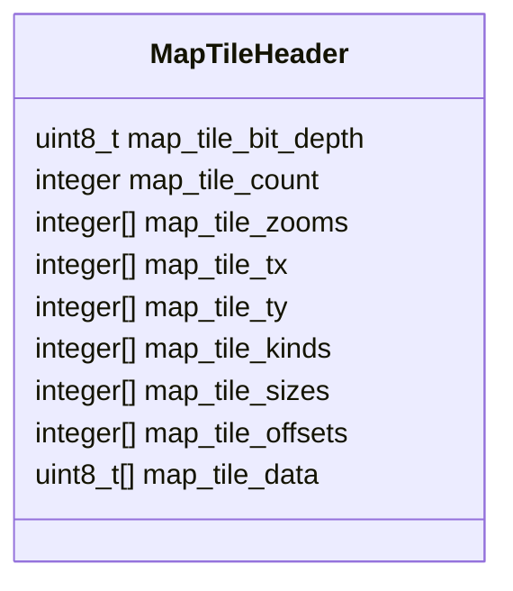

# Output formats

All downloads are assembled in the browser from one exact, deduplicated tile plan. Full-color mode produces MUI artifacts; e-ink modes produce InkHUD MTB artifacts.

## Output decision



MUI artifacts are unavailable in an e-ink mode. MTB artifacts are unavailable in full-color mode. This prevents a filename from hiding an incompatible encoding.

## Shared export lifecycle

When **Smooth Zoom Transitions** is enabled, overlapping selections with different maximum zooms gain discrete transition rings. Each successively lower zoom expands outward by one additional tile, so the exported coverage steps between detail levels without pixel blending. The same planned tile set feeds estimates and every output writer.



An export reuses the estimate hook’s exact plan when it matches the current coverage. It does not recompute intersection merely because the user pressed Download. If no completed plan is available, the export uses a dedicated planning worker.

## Tile ordering

Coverage is sorted by zoom, then X, then Y. Overlapping selections contribute one tile identified by `z/x/y`. Stable ordering makes output deterministic for a fixed render and isolates format writers from selection order.

## MUI XYZ ZIP

Downloaded filename: `MUI-Tiles.zip`.



The ZIP is rooted so extracting it at the SD-card root creates the final directory directly. Current style names come from `mapConfig.ts`:

- `osm-eink` → `/maps/liberty/`
- `osm-eink-topo` → `/maps/liberty-topo/`

MUI’s current map documentation expects 256×256 PNG tiles under `/maps/<style>/<z>/<x>/<y>.png` and recommends 8-bit, 256-color palette images. See the [Meshtastic device-ui map guide](https://github.com/meshtastic/device-ui/blob/master/maps/README.md) and [Meshtastic MUI documentation](https://meshtastic.org/docs/configuration/device-uis/meshtasticui/).

### Indexed PNG encoding



The palette has 256 entries using RGB332 quantization. Scanlines use PNG filter type 0 and are zlib-compressed. The tile therefore has one raw index byte per pixel—65,536 raw pixel bytes—although the PNG artifact is normally smaller.

### Manifest

`manifest.json` records creation time, XYZ layout, relative style path, combined selection bbox, included zooms, tile count, source, render mode, optional bit depth, topography flag, and enabled map elements. It is descriptive metadata; MUI tile lookup does not depend on it.

`ATTRIBUTION.txt` comes from the same `mapConfig.ts` function as the visible footer.

## MUI PMTiles

Downloaded filename: `liberty.pmtiles` or `liberty-topo.pmtiles`.

Destination:

- `/maps/liberty/liberty.pmtiles`
- `/maps/liberty-topo/liberty-topo.pmtiles`

The directory name and archive basename must match. MUI’s map guide says raster PNG PMTiles support begins with MUI 2.8.1; verify the exact target release before publishing an artifact for a specific firmware image.



The writer implements PMTiles specification version 3 with:

- A 127-byte header.
- Uncompressed root and leaf directories.
- Uncompressed PNG tile payloads—the PNG data is already internally compressed.
- Tile type PNG.
- Bounds and min/max zoom derived from included tiles.
- JSON metadata including attribution.

The root directory is kept within the PMTiles v3 16 KiB initial-read requirement by grouping entries into leaf directories and growing each leaf group until the root fits. See the [PMTiles v3 specification](https://github.com/protomaps/PMTiles/blob/main/spec/v3/spec.md).

## MTB pixel values

MTB names encode bits per pixel, not byte size:

| Mode | Bits/pixel | Levels | Packed bytes per 256×256 tile |
| ---- | ---------: | -----: | ----------------------------: |
| MTB1 |          1 |      2 |                         8,192 |
| MTB2 |          2 |      4 |                        16,384 |
| MTB4 |          4 |     16 |                        32,768 |

Before packing, grayscale samples use 0 for black and 255 for white. Every MTB depth follows the FastEPD contract directly: level 0 is black, the maximum level is white, and pixels are packed left-to-right from the most-significant bits. For MTB4 specifically, level 15 is white and the left pixel occupies the high nibble.

## MTB column-major packing



For depth `d`:

- `pixelsPerByte = 8 / d`
- `byteX = floor(x / pixelsPerByte)`
- `pixelIndex = x mod pixelsPerByte`
- `byteOffset = byteX * 256 + y`
- `bitShift = (pixelsPerByte - 1 - pixelIndex) * d`
- MTB4 equivalently uses `packedByte = (leftPixel << 4) | rightPixel`

This column-major organization matches the existing InkHUD MTB1 reader and tends to produce useful vertical repetition for LZ4.

## Tile payload preparation



Compression is a raw LZ4 block: no LZ4 frame, embedded original-size prefix, or checksum. The consumer already knows the uncompressed size from bit depth.

Deduplication compares compressed payload bytes. Tiles with identical packed pixels will deterministically compress identically and share an offset.

## `MapTile.bin`

Downloaded bundle: `MapTiles.zip`.

Extract the bundle at the device SD-card root. It contains:

```text
Map/MapTile.bin
LICENSE.txt
ATTRIBUTION.txt
```

`ATTRIBUTION.txt` identifies the source, style, e-ink bit depth, tile count, zoom levels, enabled map elements, terrain setting, and applicable provider attribution. `LICENSE.txt` includes the license and terms links applicable to the selected source and optional terrain data.



The diagram shows field order, not a fixed position for later sections. Exact offsets are:

- Header: 16 bytes.
- Coordinate table: `tile_count × 5` bytes.
- Record table: `tile_count × 7` bytes.
- Payload blob: the header’s payload-byte count.

Record `offset` is relative to the start of the payload blob. Sentinel records have size and offset zero.

## `MapTile.h`

Downloaded filename: `MapTile.h`.

Destination in Meshtastic firmware source:

`src/graphics/niche/InkHUD/Applets/Bases/Map/MapTile.h`

The header represents the same logical data with C arrays:

- `map_tile_attribution[]` and `map_tile_license[]` are null-terminated compile-time strings containing the same metadata and applicable terms as the SD-card bundle notices.
- These strings exist only in `MapTile.h`; the MTB1/MTB2/MTB4 binary format is unchanged.



Integer array types are selected from `uint8_t`, `uint16_t`, and `uint32_t` according to the largest value. The sparse layout declares grid and block metadata as zero. When every tile is a sentinel, `map_tile_data` contains one padding byte so the C array remains valid.

MTB1 is the established compatibility target. MTB2 and MTB4 require matching firmware readers and decompression buffers of 16,384 or 32,768 bytes respectively. Browser generation alone does not make an older firmware consumer compatible.

## Size reporting

Pre-export estimates show raw tile data:

- Full color: one indexed byte per pixel.
- MTB: packed bytes per tile based on bit depth.

Final output shows the actual artifact size and its ratio to raw pixel/packed data. It does not imply that only part of the map was exported; the percentage is storage after PNG, ZIP, LZ4, sentinels, and deduplication.

## Format change checklist

1. Identify the downstream consumer and its authoritative specification or reader implementation.
2. Preserve tile coordinate ordering unless the consumer explicitly permits a change.
3. State endianness, field widths, relative-offset base, compression framing, and pixel polarity.
4. Keep small representative byte expectations inline in tests so reviewers can understand them; do not add opaque data-only golden files.
5. Test empty input rejection, one tile, multiple zooms, sentinel tiles, duplicate payloads, and maximum relevant coordinate widths.
6. For MUI, test PNG structure and read generated PMTiles through the independent `pmtiles` package.
7. For firmware formats, validate against the actual target reader before declaring compatibility.
8. Update UI instructions, root documentation, and this file in the same change.
