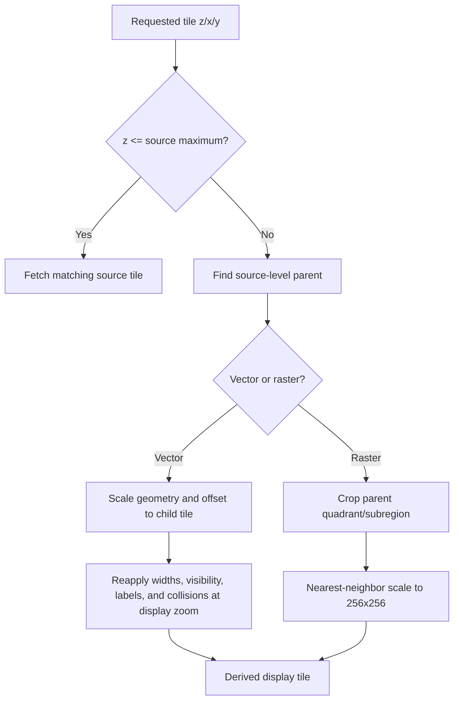
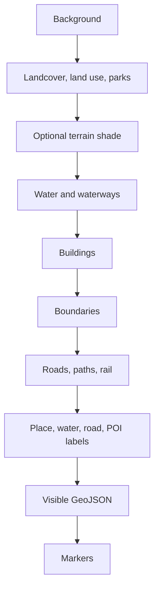
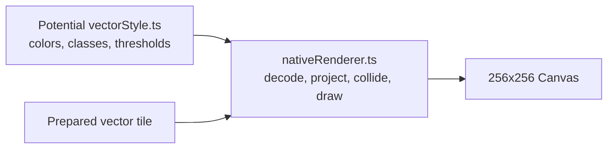
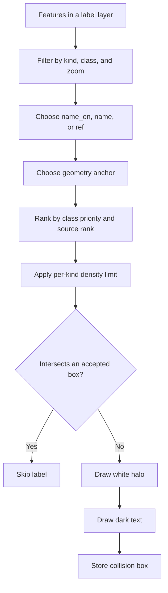
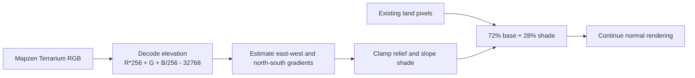
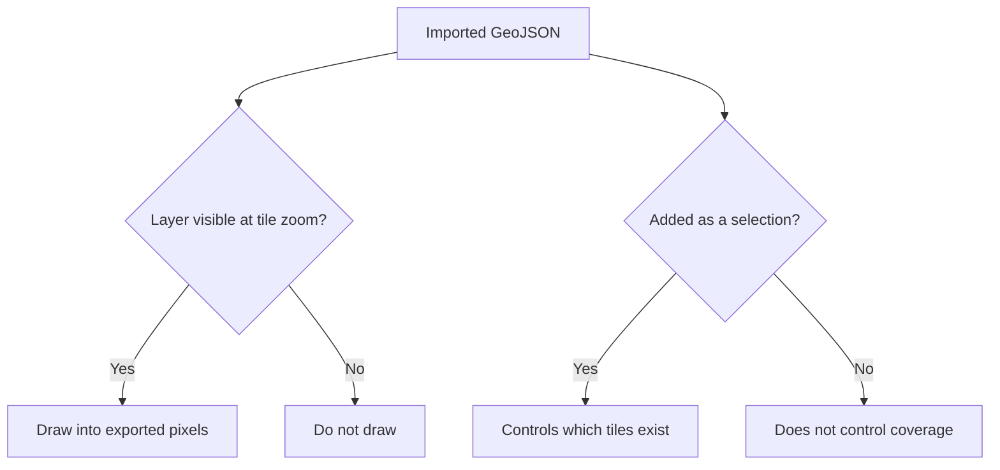
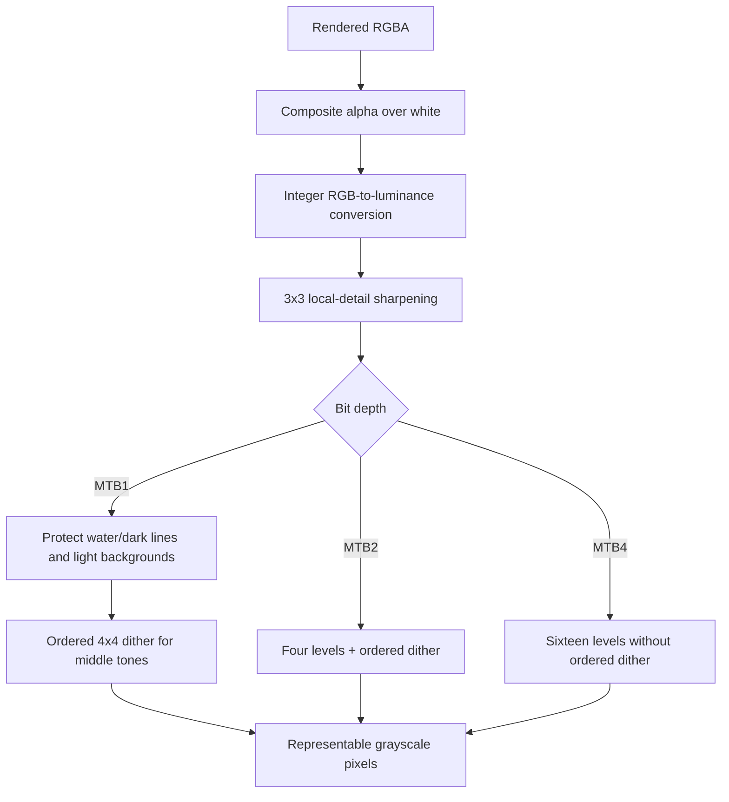

# Rendering pipeline

The project owns its renderer. It does not use MapLibre to control navigation or produce pixels. This keeps preview and export deterministic and lets the same code produce full-color MUI tiles and MTB-ready e-ink pixels.

## End-to-end pixel flow

```mermaid
flowchart LR
    Coordinate[z/x/y] --> Source{Configured source}
    Source -->|OpenFreeMap| PBF[Fetch vector PBF]
    Source -->|USGS topo| Raster[Fetch raster PNG]
    PBF --> Decode[Decode selected OpenMapTiles layers]
    Decode --> Style[Apply project Canvas style]
    Raster --> Compose[Canvas composition]
    Style --> Terrain[Optional Mapzen hillshade]
    Terrain --> Compose
    Compose --> GeoJSON[Visible GeoJSON overlays]
    GeoJSON --> Markers[Project markers]
    Markers --> Mode{Render mode}
    Mode -->|None / full color| Color[RGBA tile]
    Mode -->|MTB1 / MTB2 / MTB4| Convert[Sharpen + quantize + dither]
    Convert --> Gray[Representable grayscale pixels]
    Color --> Consumer{Consumer}
    Gray --> Consumer
    Consumer --> Preview[Browser preview]
    Consumer --> Export[Export writer]
    Preview --> Chrome[Purple selection outlines]
```

Purple selection geometry is drawn only after the preview’s final conversion. It is not part of `renderNativeTile` and cannot leak into downloads.

## Source behavior

| Source      | Kind                    | Native maximum | Geographic scope | Element controls | Derived zoom behavior                                                          |
| ----------- | ----------------------- | -------------: | ---------------- | ---------------- | ------------------------------------------------------------------------------ |
| OpenFreeMap | OpenMapTiles vector PBF |            z14 | Worldwide        | Yes              | Parent vector geometry is scaled and clipped, then labels and styles are rerun |
| USGS topo   | Prerendered raster PNG  |            z16 | United States    | No               | Parent raster pixels are cropped and scaled without smoothing                  |

`mapConfig.ts` is the authority for native maximum zoom. The UI can display and export through z20. A label such as `z14 +4` means display zoom 18 using a z14 source tile.

## Native and derived zoom

Vector derived zoom is not screenshot enlargement. Geometry comes from the highest available source tile, but style thresholds, line widths, label density, and label placement use the requested display zoom. It can reveal labels already present in the source data, but it cannot invent missing geometry or attributes.

Raster derived zoom contains no new information. It exists so output zoom ranges remain consistent across sources.

## Vector layer contract

The native renderer currently reads these OpenMapTiles-style layers:

| Layer                                               | Use                             |
| --------------------------------------------------- | ------------------------------- |
| `landcover`, `landuse`, `park`                      | Land and green-area fills       |
| `water`, `waterway`                                 | Water polygons and lines        |
| `building`                                          | Building fill and outline       |
| `boundary`                                          | Administrative boundary lines   |
| `transportation`                                    | Roads, paths, and rail geometry |
| `place`, `water_name`, `transportation_name`, `poi` | Text candidates                 |

Adding a tile provider that uses a different vector schema requires an adapter or renderer changes. A PBF endpoint alone is not sufficient.

## Canvas composition order

Later stages can cover earlier ones. When changing order, verify both full-color and e-ink output; a harmless color overlap can become an unreadable dark mass after quantization.

## Styling policy

The renderer uses a small project-owned style inspired by OpenFreeMap’s Liberty reference style. It is not a general Mapbox/MapLibre style interpreter and does not promise pixel parity with Liberty.

Style policy currently includes:

- Full-color and e-ink-aware palettes.
- Feature-class groups for motorway, trunk, primary, secondary, tertiary, minor, service, paths, and rail.
- Zoom-dependent casing and fill widths.
- Per-source element availability.
- Per-label-kind minimum zoom, density, priority, and collision spacing.

The clean future seam is to move declarative colors, layer names, class groups, and thresholds into a `vectorStyle.ts` module while keeping Canvas path construction and drawing in the renderer. Do not split drawing into one file per feature type solely to reduce line count; that would hide composition order and shared mechanics.

## Labels

Current minimum display zooms are place z4, water z6, POI z13, and road z16. At z18 and above, road-label density increases and road labels use a separate collision set so local streets are not suppressed by place labels. Collision is tile-local; labels near tile edges may differ from a full GL renderer.

When changing labels, test at low, native-maximum, and derived zooms. The most important checks are legibility after MTB1 conversion, duplicate density, clipped edge labels, and stable performance.

## Terrain

Terrain is optional. A missing or failed terrain request leaves the vector base intact. The current renderer requests Terrarium data using the display tile coordinate; availability at high derived zooms is therefore provider-limited and failure is intentionally nonfatal.

## GeoJSON and markers

- A visible GeoJSON layer is drawn into preview and export only within the layer’s zoom range.
- Converting a layer to a selection controls coverage but does not create a second rendered copy.
- Markers are always rendered when their coordinate falls within a tile.
- A marker is either a shared pin plus label or a centered label-as-marker.
- Selection boundaries are separate editor chrome, even when their geometry originated from GeoJSON.

## E-ink conversion

The conversion intentionally does more than generic grayscale. Road styling happens before conversion, water receives special treatment, and local sharpening preserves structural detail. Preview calls the same conversion worker as export.

## Render caching and cancellation

The renderer keeps small in-memory least-recently-used maps for prepared vector tiles and completed render promises. The rendered key combines project ID, render revision, and `z/x/y`; preview and export therefore reuse identical work.

Abort signals stop consumers from using obsolete results. Shared cached promises are not aborted at the network layer because another consumer may still need them. Failed promises are removed so a later attempt can retry.

See [State and caching](state-and-caching.md) for the complete invalidation model.

## Safe renderer change checklist

1. Identify whether the change affects source decoding, style policy, geometry, labels, overlays, or conversion.
2. Keep full-color and e-ink paths in the same renderer.
3. Ensure the initiating UI mutation uses `saveRender`.
4. Add a focused test using inline, readable input values when the behavior can be expressed without network or Canvas.
5. Run `npm run check` and `npm run build`.
6. Inspect at least one low zoom, one native maximum zoom, and one derived zoom.
7. Check full color, MTB1, MTB2, and MTB4 before changing shared color or line policy.
