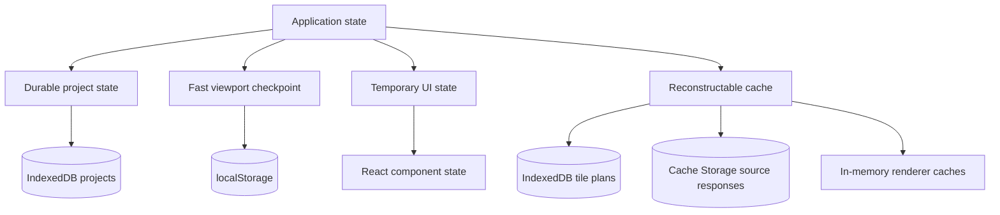
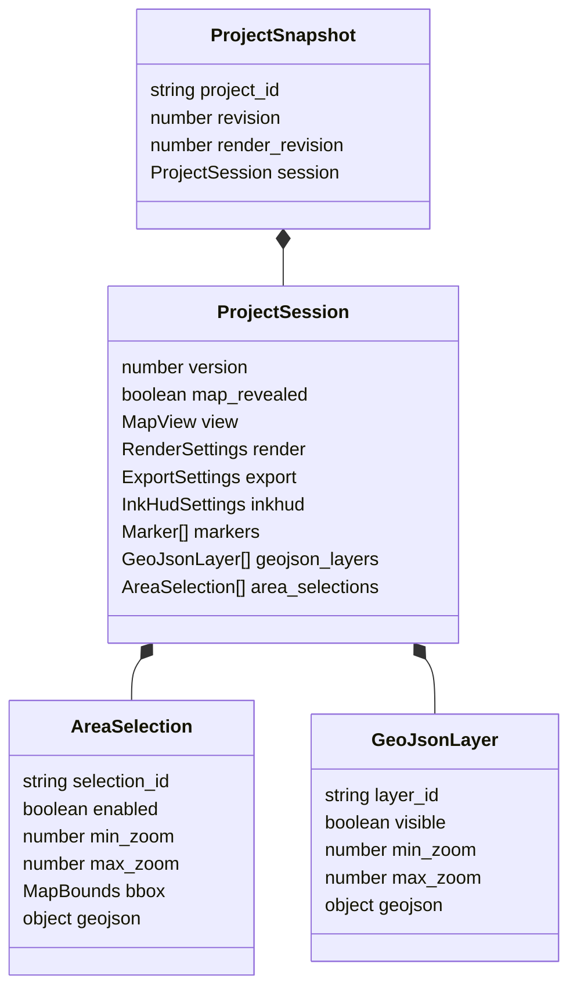
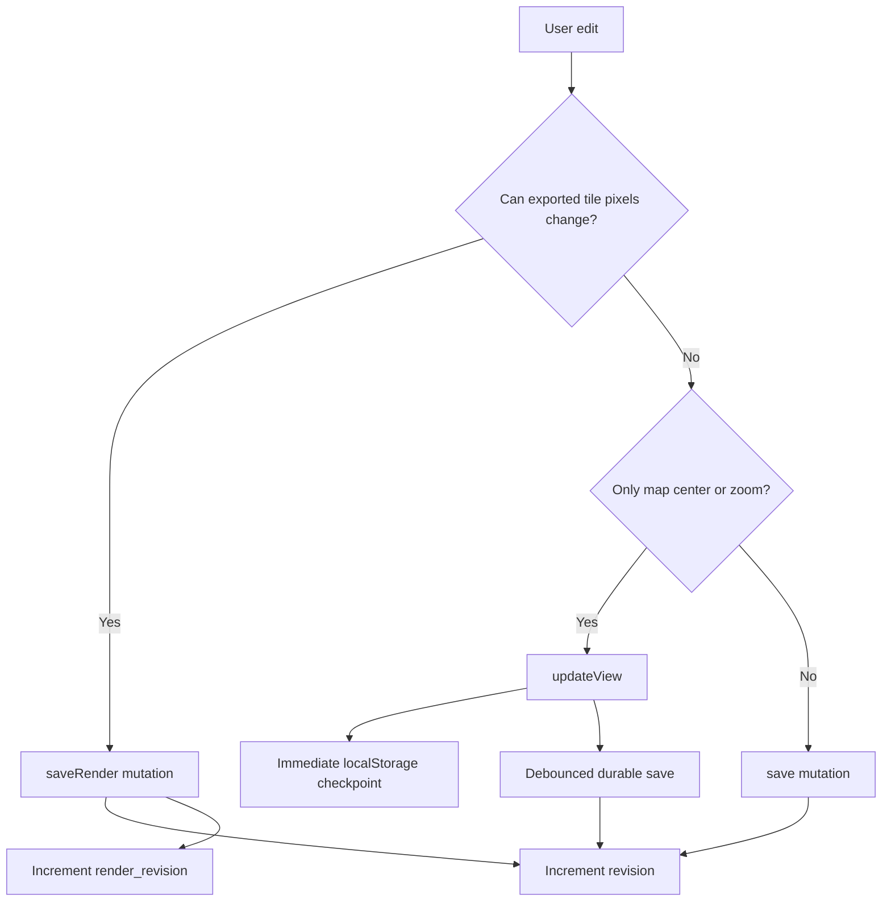
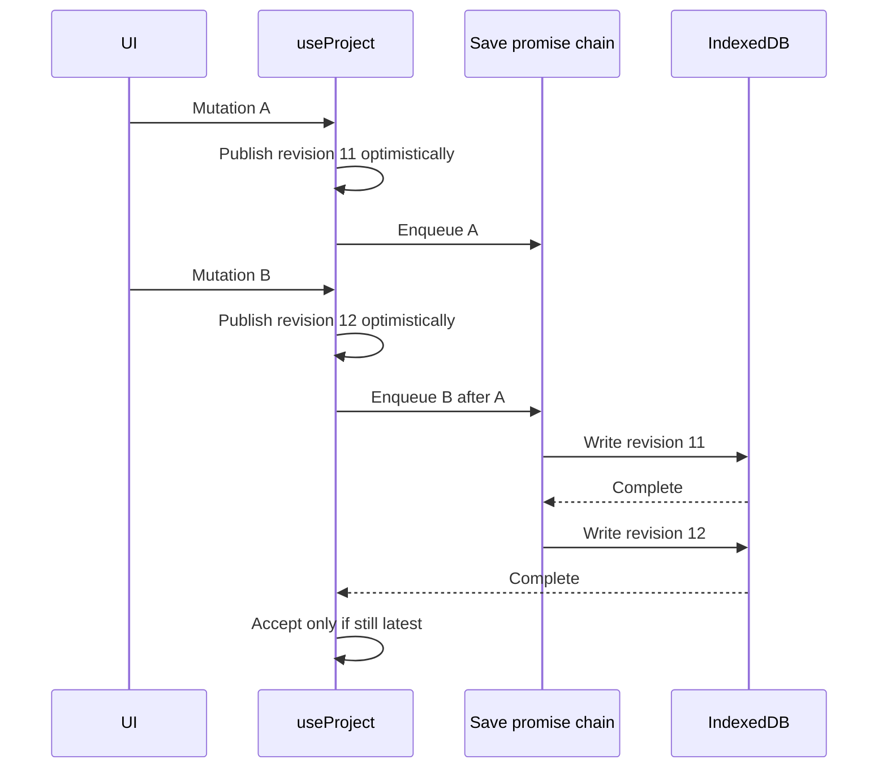
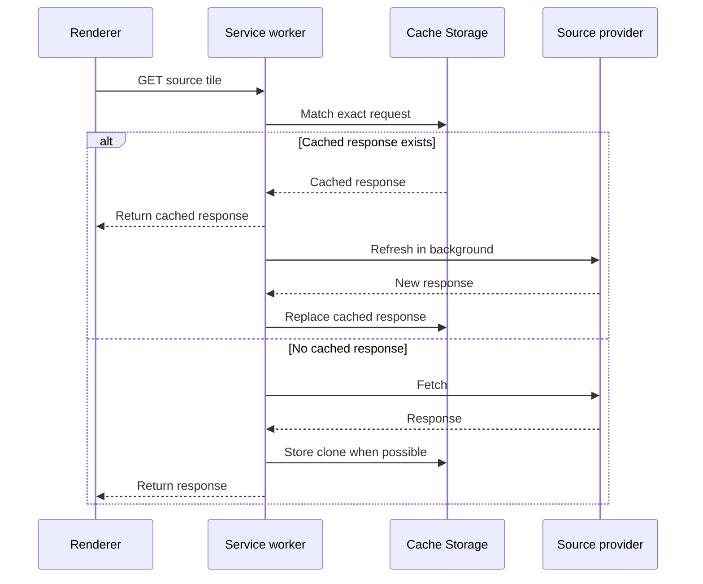
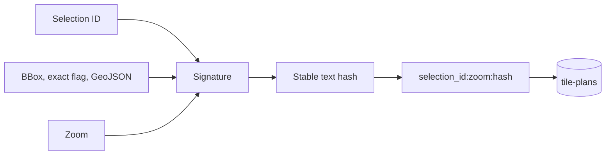
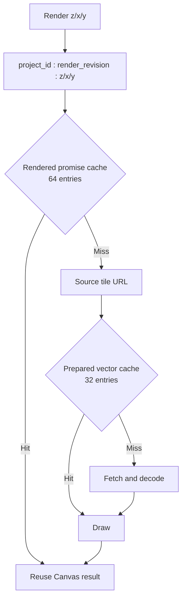
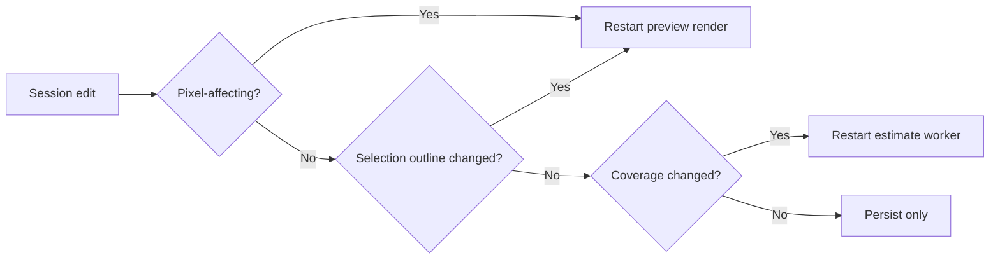

# State, persistence, and caching

The browser keeps one portable project session and several disposable acceleration layers. Correctness must come from the session and source providers; caches may disappear at any time.

## State categories

| Category              | Examples                                          | Survives reload  | Portable session                   |
| --------------------- | ------------------------------------------------- | ---------------- | ---------------------------------- |
| Durable project       | Source, style, markers, GeoJSON, selections       | Yes              | Yes                                |
| View checkpoint       | Center and zoom during/after panning              | Yes              | Included once durable save settles |
| Temporary UI          | Search results, expanded sections, active export  | No               | No                                 |
| Reconstructable cache | Source tiles, exact tile plans, rendered canvases | Depends on cache | No                                 |

## Session schema

`models.ts` defines the shape. `session.ts` creates defaults and normalizes all imported or stored values. Version 3 is the only accepted portable schema. There is deliberately no silent version-2 migration.

When changing persisted shape:

1. Decide whether the change can be represented by a defaulted optional field without a new schema version.
2. Update the model, default session, and normalizer together.
3. Add tests for valid, missing, malformed, and out-of-range input.
4. If the meaning of existing data changes incompatibly, increment the session version deliberately and design the migration as a separate change.

## Save paths

Use `saveRender` for:

- Map source, style, element, or conversion changes.
- Marker add/edit/move/delete.
- GeoJSON visibility, zoom range, content, or removal.

Use `save` for:

- Selection enabled state, geometry, or zoom range. Selection boundaries are editor chrome; coverage changes do not alter the pixels inside an already selected tile.
- Attribution acknowledgement.
- Revealing or positioning the map as part of a search workflow.

Use `updateView` for panning, wheel zoom, and fit operations.

If uncertain, ask: “Could the same `z/x/y` tile produce different exported RGBA pixels after this edit?” If yes, use `saveRender`.

## Serialized optimistic saves

The queue prevents a slow older write from overwriting a newer edit. Editable arrays and objects are copied before mutation, while large imported GeoJSON payloads remain shared by reference under the invariant that their content is immutable.

On a latest-write failure, the hook restores the prior durable snapshot while preserving the newest viewport. Older failed writes do not roll back newer optimistic edits.

## Storage inventory

### IndexedDB

Database: `eink-map-tiles`, database version 2.

| Store        | Key                | Value                       | Authority                       |
| ------------ | ------------------ | --------------------------- | ------------------------------- |
| `projects`   | `project_id`       | `ProjectSnapshot`           | Durable local project           |
| `tile-plans` | computed cache key | signature, tiles, save time | Disposable exact-coverage cache |

The IndexedDB database version is an object-store migration number; it is unrelated to portable session version 3.

### localStorage

| Key                                  | Purpose                    |
| ------------------------------------ | -------------------------- |
| `eink-map-browser-project`           | Current project ID         |
| `eink-map-browser-view:<project_id>` | Latest viewport checkpoint |

localStorage failure is nonfatal. IndexedDB remains the durable project store.

### Cache Storage

The service worker owns caches prefixed `eink-map-`. It currently caches unchanged GET responses only from the configured OpenFreeMap, USGS, and Mapzen source hosts.

Application HTML and hashed bundles are not intercepted by this source-response cache. Vite’s local server handles development freshness; static deployments should serve the entry page with revalidation so browsers discover the latest content-hashed asset references.

## Tile-plan cache

Exact coverage calculation is cached per selection and zoom.

The full signature is stored beside the hashed key and compared on read. The hash locates the entry; the signature prevents a collision from returning the wrong plan. Plans from enabled selections are merged and deduplicated in the worker.

Changing output depth does not change geometry and therefore only recomputes byte totals. Changing a selection’s geometry, enabled state, or zoom range changes the coverage snapshot and restarts exact planning after a short debounce.

## Renderer caches

Both caches are memory-only and least-recently-used. Promises are cached so concurrent preview and export requests share in-flight work. Rejected entries are removed and may be retried.

`render_revision` is part of the rendered cache namespace. That is why calling the correct save function is essential.

## Preview invalidation

The map rerenders for:

- View center or zoom changes.
- A new render revision.
- A visible selection-outline change.
- Container size changes.

Selection minimum/maximum export zoom and attribution acknowledgement do not rerender the preview. The estimate worker may still recalculate coverage.

## Reset scope

Reset removes only application-owned state:

- Current-project and viewport localStorage keys.
- The `eink-map-tiles` IndexedDB database.
- Cache Storage names beginning with `eink-map-`.

It does not clear unrelated browser storage, other origins, downloads, or operating-system files.

## Cache change checklist

1. State the correctness authority and treat the new cache as disposable.
2. Define a deterministic key and the inputs that invalidate it.
3. Bound memory caches.
4. Remove rejected promises so transient failures remain retryable.
5. Make cache read/write failure nonfatal unless the cache is itself the requested artifact.
6. Add reset coverage for any new durable browser cache.
7. Document whether cached data contains third-party responses, user data, or derived data.
