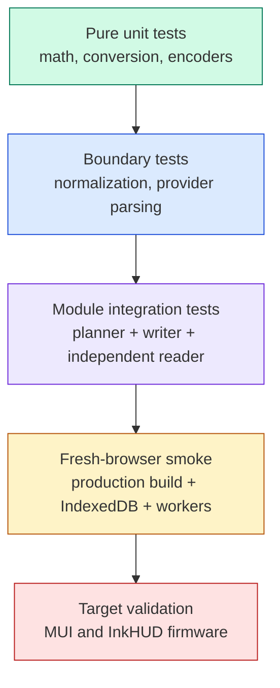
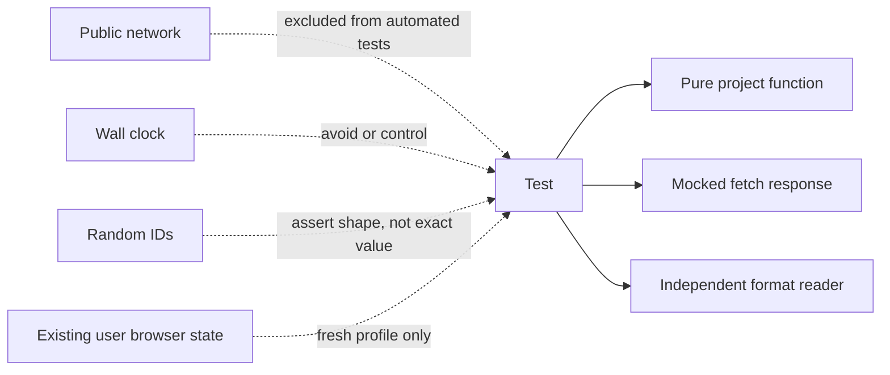
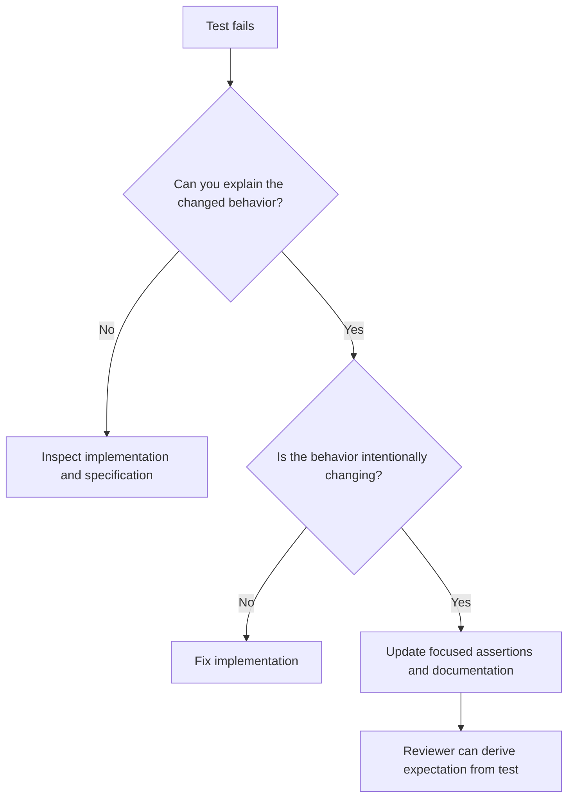
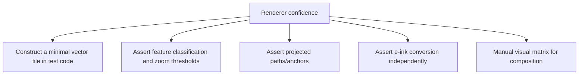
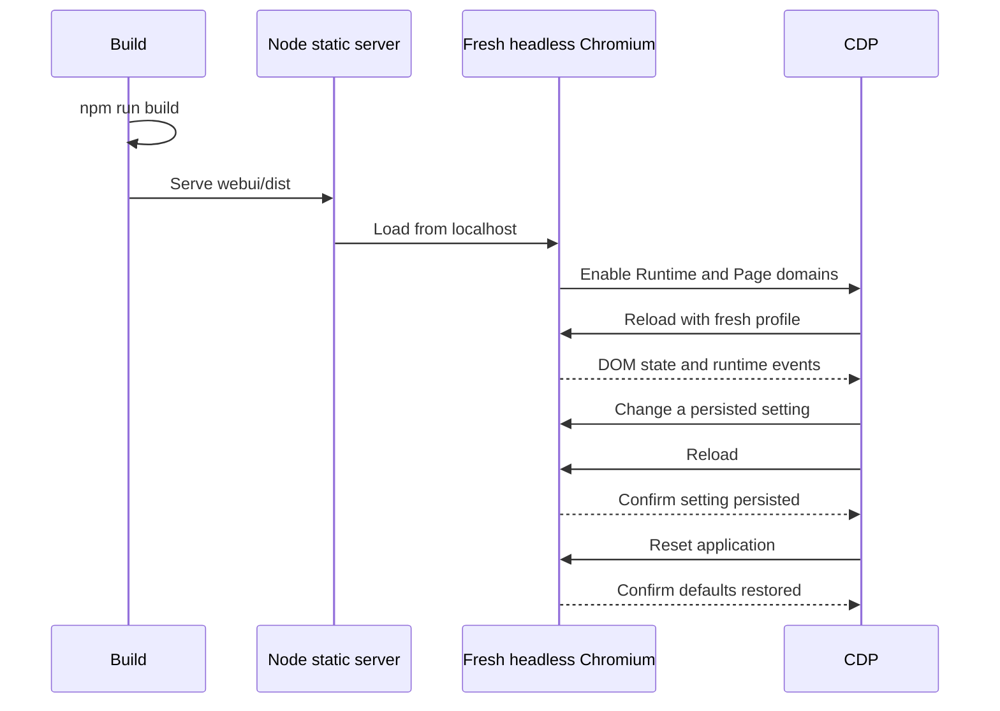
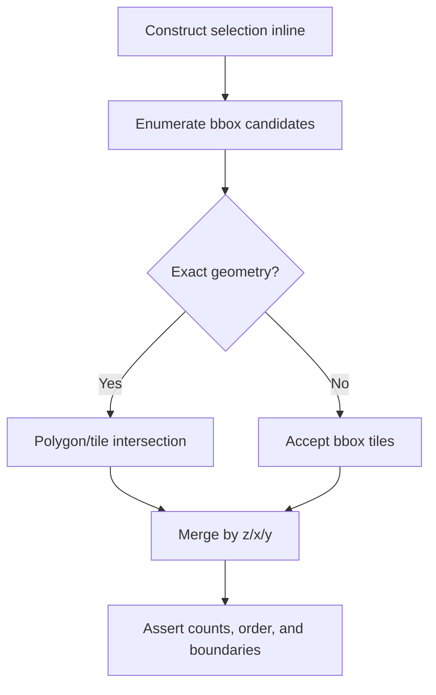
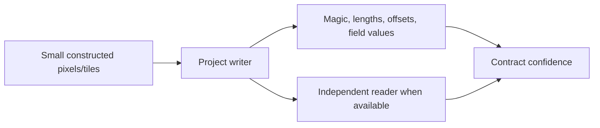
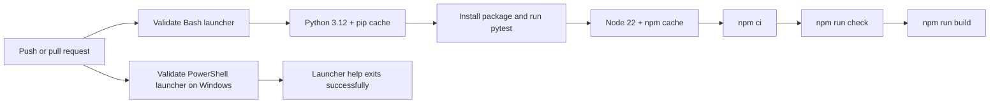
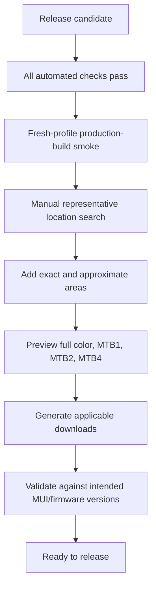

# Testing strategy

Tests protect contracts at the cheapest reliable level. Most behavior is pure TypeScript and belongs in Vitest. Browser smoke testing verifies wiring with the system Chromium and Chrome DevTools Protocol (CDP); the project does not require Playwright.

All Python-based tests live under `tests/`; `pyproject.toml` defines that directory as pytest's test root.

The project also avoids opaque data-only golden files. Small representative inputs and expected bytes belong inline in readable tests. Larger renderer confidence should come from generated fixtures whose construction is code-reviewed, structural assertions, and explicit visual checks.

## Test layers



Use the lowest layer that can actually detect the regression. Do not route pure byte packing through a browser. Do not claim device compatibility from a unit test alone.

## Existing suites

| Test file               | Primary contract                                                                              |
| ----------------------- | --------------------------------------------------------------------------------------------- |
| `eink.test.ts`          | Luminance, quantization, dithering, and column-major packing                                  |
| `tiles.test.ts`         | XYZ math, antimeridian behavior, polygon filtering, deduplication, estimates, and cache reuse |
| `geojson.test.ts`       | Coordinate collection, bounds, primitive counting, and selection geometry                     |
| `mercator.test.ts`      | Projection, inverse projection, viewport fitting, and wrapped bounds                          |
| `session.test.ts`       | Defaults and strict version-3 normalization                                                   |
| `search.test.ts`        | Search normalization and provider fallback/boundary ordering with mocked fetches              |
| `mapConfig.test.ts`     | Source limits, labels, style names, and attribution                                           |
| `mtb.test.ts`           | Raw LZ4, sentinels, deduplication, C header, and binary layout                                |
| `muiPng.test.ts`        | Indexed PNG chunks and pixel representation                                                   |
| `pmtilesWriter.test.ts` | Archive readability and metadata through the independent `pmtiles` library                    |
| Python tests            | Preserved desktop and shared Python-core behavior                                             |
| Launcher tests          | Bash behavior, cross-platform option parity, and Windows PowerShell help validation           |

## Deterministic test boundary



Automated tests must not depend on Nominatim, Photon, Overpass, TIGERweb, OpenFreeMap, USGS, or Mapzen availability. Provider behavior is exercised with mocked `fetch`. Live-provider checks are manual release diagnostics, not CI gates.

## Inline fixtures instead of golden files

Use small constructions that show why the expectation is correct:

```ts
const pixels = new Uint8Array(256 * 256).fill(255);
pixels[0] = 0;
const packed = packMtbColumnMajor(pixels, 1);

expect(packed[0]).toBe(0b00000001);
expect(packed.slice(1).every((byte) => byte === 0)).toBe(true);
```

Good inline fixtures are:

- Small enough to inspect in the test.
- Constructed according to the behavior being tested.
- Named for the condition they represent.
- Asserted structurally or with a small explicit byte sequence.

Avoid:

- Committed binary blobs with no obvious provenance.
- Large JSON snapshots that reviewers cannot reason about.
- Updating expected output merely because a test failed.
- Pixel-perfect screenshots as the only renderer assertion.



## Renderer testing without data-only goldens

Renderer tests should separate concerns:



A future vector fixture should be generated by a test helper from a few named features, not checked in as an unexplained `.pbf`. A future terrain fixture should be generated from a tiny mathematical elevation surface in the test, not stored as an unexplained PNG.

Canvas composition can then be checked with targeted properties—for example, a road center pixel is lighter than its casing, a disabled layer leaves the background unchanged, or selection chrome is absent from `renderNativeTile`—without treating a complete screenshot as an unquestionable oracle.

## Browser smoke testing without Playwright

Use the locally installed Chromium and CDP. This keeps the release smoke small and avoids downloading or maintaining a second browser automation stack.



Minimum smoke assertions:

- Document title is `E-ink Map Tiles`.
- The neutral pre-map screen appears with no Canvas.
- Primary sidebar sections start collapsed.
- The footer version matches `webui/package.json`.
- No `Runtime.exceptionThrown` or error console events occur.
- A session edit survives reload.
- Reset returns the session to defaults.
- The estimate worker loads successfully.

When this becomes a checked-in CI test, prefer a small Node script using the runtime’s WebSocket/CDP support and the runner’s installed Chromium. Keep it narrowly focused on application wiring. Do not reproduce a general-purpose browser framework.

## Coverage-planning tests



Always include z0 and an antimeridian-crossing bbox when modifying tile math. For exact shapes, choose a simple polygon where the expected included/excluded tiles can be reasoned about without GIS software.

## Format tests



- Assert both semantic fields and byte layout for custom MTB formats.
- Exercise all-white, all-black, compressed, and deduplicated payloads.
- Decode MUI PNG chunks rather than comparing an entire PNG blob.
- Open PMTiles output with the independent `pmtiles` package.
- Firmware support still requires validation against actual firmware readers.

## Commands

From `webui/`:

```bash
npm ci
npm run check
npm run build
```

`npm run check` runs strict TypeScript, ESLint, Prettier, and Vitest.

From the repository root:

```bash
python -m pytest -q
bash -n scripts/eink-map-tiles.sh
./scripts/eink-map-tiles.sh --help
git diff --check
```

## CI flow



The production build is part of CI because worker URL generation, JSON imports, and output directory behavior are not fully exercised by typechecking alone.

## Change-to-test matrix

| Change                | Minimum verification                                                   |
| --------------------- | ---------------------------------------------------------------------- |
| Component copy/layout | Typecheck, lint, formatting, focused browser inspection                |
| Session field         | Normalization tests, save/reload smoke                                 |
| Source/provider       | Mocked success/error/malformed tests, attribution check                |
| Tile math             | z0, antimeridian, polygon, dedupe, and cache tests                     |
| Renderer policy       | Pure policy tests where possible plus manual zoom/depth matrix         |
| MTB writer            | Byte-level tests plus target firmware validation                       |
| MUI writer            | PNG structure or independent PMTiles reader plus target MUI validation |
| Worker protocol       | Both worker and client typecheck, success/error/cancellation paths     |
| Service worker        | Fresh profile, repeat request behavior, Reset                          |

## Release verification


